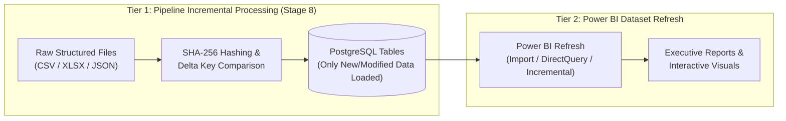

# Power BI Refresh Strategy Guide

This guide describes data refresh strategies for Power BI reports connected to the PostgreSQL analytical database, clarifying the operational relationship between pipeline incremental loading and Power BI report refreshes.

---

## 1. Two-Tier Incremental Architecture

It is critical to distinguish between **Pipeline Incremental Loading (Stage 8)** and **Power BI Incremental Refresh**:

| Dimension | Pipeline Incremental Processing (Stage 8) | Power BI Incremental Refresh |
| :--- | :--- | :--- |
| **Location** | Python Orchestration Engine (`pipeline/incremental.py`). | Power BI Desktop / Service (VertiPaq Engine). |
| **Scope** | Discovers new/modified raw files and syncs deltas into PostgreSQL. | Discovers new/modified database records and partitions in-memory report cache. |
| **Mechanisms** | Chunked file hashing, delta key comparison, atomic JSON checkpoints. | M Parameters (`RangeStart`, `RangeEnd`), table partition slicing. |
| **Automation** | Fully automated and tracked inside `state/checkpoints.json`. | Configured within Power BI Desktop and scheduled in Power BI Service. |

---

## 2. Refresh Options in Power BI

### A. DirectQuery (Zero Refresh Delay)
* **How it Works**: Every visual interaction executes a real-time SQL query against PostgreSQL.
* **Refresh Strategy**: No scheduled data refresh required. When the Python pipeline updates PostgreSQL tables, subsequent user clicks or report page refreshes immediately reflect the updated numbers.
* **Trade-off**: Requires a responsive PostgreSQL database capable of handling concurrent analytical queries without degrading.

### B. Standard Scheduled Import Refresh
* **How it Works**: Power BI pulls all rows from PostgreSQL on a scheduled frequency (e.g. daily, hourly via Power BI Gateway).
* **Refresh Strategy**: Schedule the Power BI dataset refresh window 15–30 minutes *after* the Python pipeline orchestration run finishes.
* **Trade-off**: Full table reloads can become slow as historical row counts grow.

### C. Power BI Incremental Refresh
* **How it Works**: Partitions large tables by date ranges. Only recent partitions (e.g., the last 7 days) are refreshed from PostgreSQL; historical partitions (e.g., older than 30 days) remain frozen in memory.
* **Prerequisites in Power BI**:
  1. The target table must have a continuous `datetime` or `timestamp` column.
  2. Create two Power Query parameters: `RangeStart` (DateTime) and `RangeEnd` (DateTime).
  3. Filter the date column in Power Query using:
     `[DateColumn] >= RangeStart and [DateColumn] < RangeEnd`
  4. Right-click the table in Power BI Desktop -> Select **Incremental Refresh**.
  5. Define historical retention (e.g. "Store rows where date is in the last 2 years") and refresh window (e.g. "Refresh rows where date is in the last 7 days").
  6. Publish to Power BI Service (requires On-premises Data Gateway for private PostgreSQL instances).

> [!NOTE]
> Power BI incremental refresh is not automatically configured by Python code alone; it requires configuring `RangeStart` and `RangeEnd` parameters inside Power BI Desktop and deploying to Power BI Service.
